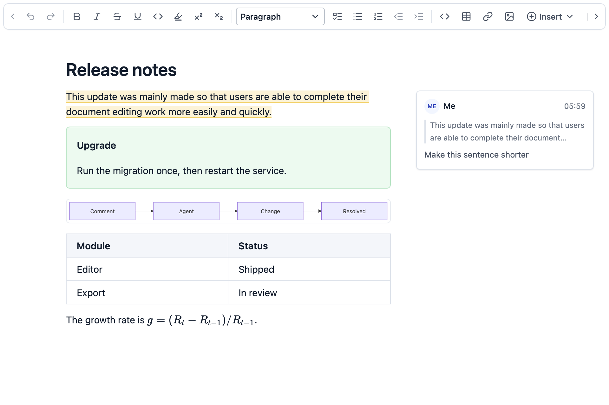

<div align="center">

# QuireKit MD Editor for DeepSeek Harness

Edit Markdown where the agent writes it, and hand your comments back to the agent.

[](./LICENSE.md)
[](https://www.npmjs.com/package/dsh-quirekit-md-editor)
[](#installation)

English | [简体中文](./README.zh-CN.md)



</div>

DeepSeek Harness previews Markdown in its right sidebar. This plugin makes that preview editable: open a `.md` file, change the rendered document, and it saves back to the same file. The editor is [QuireKit MD Editor](https://msfe.quirekit.com/en/md-editor/), which you can try on its website.

## Highlights

- **Comments drive the agent.** Comment on a passage and send it to the agent. After making the change, the agent marks that comment resolved. Comments it did not act on stay open.
- **Fast on long documents.** In a 1,000,000-character document, a keystroke updates the editor in 2.4 ms at the median and 3.0 ms at p95. See [Performance](#performance).
- **Your file stays yours.** It is still plain Markdown. Only what you edit changes, and the rest stays byte-for-byte identical. Comments live in a separate file.

<p align="center"></p>

## Why this editor

Several plugins can edit Markdown in DeepSeek Harness. This one is built around what happens after the agent has written a document: you read it, change it and tell the agent what to fix.

- **Comments are part of the editor.** Threads with replies sit beside the text and follow it as the document changes. Each one can go to the agent and close itself when the work is done.
- **Every edit is an edit to the plain Markdown text.** Visual, Markup and Source are one CodeMirror editor that only displays the text differently. The file is not regenerated from a document tree, so a one-character edit is a one-character diff, even with setext headings, `*` and `+` lists, tilde fences, raw HTML or unusual tables. `npm run benchmark:fidelity` checks this in all three modes.
- **The plugin and the editor are built together.** QuireKit builds the editor on optimized versions of CodeMirror and Lezer, and everything the plugin needed went into its public API.

## Features

**Editing**

- Three modes, remembered per tab: Visual hides Markdown marks, Markup shows them on the current paragraph, and Source shows everything.
- Math, Mermaid, PlantUML, tables, footnotes and frontmatter render in place. Whiteboards, flowcharts and mind maps can be inserted, with their data stored in the Markdown.
- Saves as you type, or with `Cmd/Ctrl+S`.
- Pasted images are saved to `assets/` beside the document and referenced by relative path.
- Follows the DeepSeek Harness language and light or dark theme.

**Working with the agent**

- Send selected text to the composer with its file path and lines, then decide whether to send it.
- Send one comment or all open comments. The agent resolves each one it handles through the `resolve_document_comment` tool.
- If the agent changes the file, the editor updates when you have nothing unsaved. If you do, it asks which version to keep and never overwrites silently.
- The bundled `quirekit-markdown` Skill lets the agent write callouts, collapsible sections, Mermaid, PlantUML and math.
- Local screenshots display from relative and absolute paths. Only image files are read.

<p align="center"></p>

The comment rail can be hidden and shown at any time, and the toolbar menu switches back to the official Markdown preview.

## Installation

Requires the DeepSeek Harness Web UI, `>=0.2.2-rc.1 <0.3.0`.

```bash
dsh plugin --profile web add dsh-quirekit-md-editor
```

Restart `dsh web`, then open a Markdown file from the Files tab.

To install from source:

```bash
npm install
npm run build
dsh plugin --profile web add file:/absolute/path/to/dsh-md-editor
```

## Settings

On the DeepSeek Harness Plugins page you can choose the default mode, whether the mode switch appears, and whether the formatting toolbar is fixed, floating or hidden. Settings are saved in this browser.

## Performance

These numbers come from the same editor code the plugin runs, in a browser engine with no native rendering layer. A keystroke in a document ten times longer costs less than a third more, and most of the remaining cost comes from the number of blocks. That comes from QuireKit's work on two open-source cores:

- **An optimized Lezer.** Unchanged groups of the syntax tree are reused whole after an edit, so incremental parsing no longer grows with document length. The editor also skips its second parse pass when link definitions did not change.
- **An optimized CodeMirror.** On top of drawing only the visible part, it draws further ahead during fast scrolling, and it locks the content height while rebuilding the drawn window so the scroll position stays put.

| Document | Characters | Mode | Open | Update p50 | p90 | p95 | p99 | Next frame p50 | Next frame p95 |
| --- | ---: | --- | ---: | ---: | ---: | ---: | ---: | ---: | ---: |
| Long-form | 100,000 | Visual | 145 ms | 2.0 | 2.3 | 2.5 | 3.1 | 8.9 | 10.0 |
| Long-form | 100,000 | Markup | 115 ms | 2.0 | 2.4 | 2.5 | 3.4 | 9.2 | 10.2 |
| Long-form | 100,000 | Source | 106 ms | 1.6 | 1.9 | 2.1 | 2.8 | 8.8 | 9.8 |
| Long-form | 1,000,000 | Visual | 113 ms | 2.4 | 2.9 | 3.0 | 3.4 | 9.1 | 10.2 |
| Long-form | 1,000,000 | Markup | 117 ms | 2.6 | 3.0 | 3.2 | 4.5 | 9.0 | 10.1 |
| Long-form | 1,000,000 | Source | 106 ms | 1.8 | 2.2 | 2.3 | 2.8 | 8.9 | 9.8 |
| Structure-heavy | 1,000,000 | Visual | 144 ms | 6.4 | 6.8 | 7.0 | 10.9 | 9.1 | 10.8 |
| Structure-heavy | 1,000,000 | Markup | 141 ms | 6.6 | 7.1 | 7.3 | 9.3 | 9.3 | 10.5 |
| Structure-heavy | 1,000,000 | Source | 112 ms | 2.6 | 3.3 | 3.6 | 4.9 | 8.8 | 10.0 |

Times are in milliseconds, over 200 keystrokes typed mid-document, with cold inputs included. Measured on an Apple M3 Max running other work, in Chromium 149.

The editor runs in its own iframe, so the DeepSeek Harness page's styles don't affect it. In the real sidebar (1,000,000 characters, Visual mode, 100 keystrokes), input through processing and layout takes about 4 ms at p50 and about 5 ms at p95.

- **Update** is from key press to the editor accepting the new document.
- **Next frame** is from key press to the frame carrying the new text being produced.
- **Open** is from creating the editor to its first paint.
- **Long-form** documents have some structure every few thousand characters. **Structure-heavy** documents have a table, code block or callout about every 400 characters, the worst case here, with cost growing with the number of blocks.

Keys are sent through the browser's automation protocol, so this excludes the keyboard, operating system, input method and display. Results vary by machine. To run it yourself:

```bash
npm install
npx playwright install chromium
npm run benchmark
```

It prints this table and saves the raw summary to `build/benchmark/results.json`. The scenarios are in [`benchmark/`](./benchmark). `npm run benchmark:fidelity` runs the source-preservation check.

## Built on QuireKit

[QuireKit](https://quirekit.com) is an open-source framework for building document editors, and this plugin is one small example of what it can do. The editor you use here is also a component for your own product:

```bash
npm install @quirekit/md-editor
```

See the [integration guide](https://msfe.quirekit.com/en/guide/md-editor). QuireKit also includes [MSFE](https://msfe.quirekit.com/en/), the source-first Markdown framework underneath this editor, a block editor, and a paginated editor that lays out real pages in the browser.

## Permissions

- Editing follows the session sandbox mode, so documents are read-only in read-only sessions.
- Only regular files inside the workspace can be saved, and final symlinks are not followed. Markdown outside the workspace opens read-only.
- Relative images in a document can only read image files inside the workspace.
- Every request passes DeepSeek Harness authentication and same-origin checks.

## Limitations

- Files are limited to 4 MB and images to 20 MB.
- Files that mix LF and CRLF cannot be edited. Normalize the line endings or switch to the Markdown preview.
- Pasting images needs a local workspace, because the DeepSeek Harness file service can currently only write text.
- The editor is about 36 MB (about 11 MB gzipped) and loads only when a Markdown file is opened.
- The editor runs in an iframe: DeepSeek Harness keyboard shortcuts don't reach it while it has focus, and its menus stay inside the sidebar.
- Not yet verified on the DeepSeek Harness desktop app.

## Development

```bash
npm install
npm test
npm run build
```

The build writes `lib/client.js` and regenerates `THIRD_PARTY_NOTICES.md` from what was actually bundled.

To build or benchmark against a QuireKit checkout:

```bash
QUIREKIT_LOCAL=/absolute/path/to/quirekit npm run build
QUIREKIT_LOCAL=/absolute/path/to/quirekit npm run benchmark
```

## Contributing

Issues and pull requests are welcome. Please run `npm test` before opening a pull request, and include `npm run benchmark` results for changes that may affect typing.

## License

[MIT](./LICENSE.md). Bundled dependencies are listed in [THIRD_PARTY_NOTICES.md](./THIRD_PARTY_NOTICES.md).
