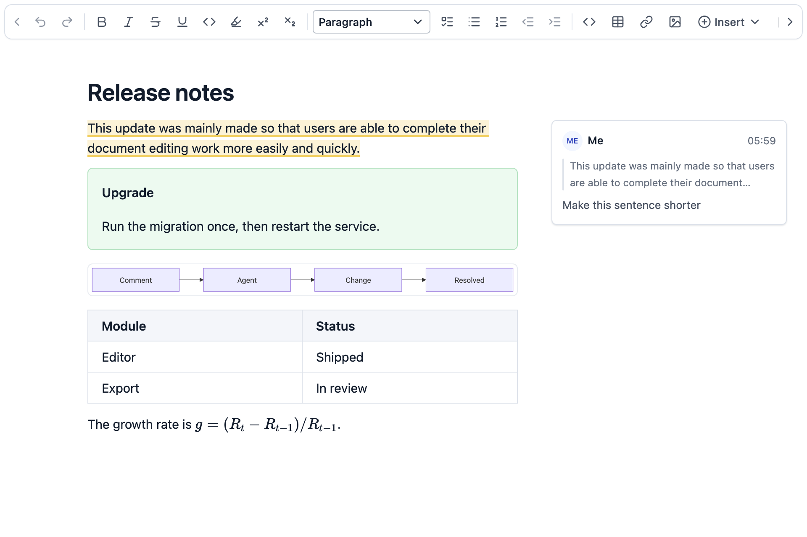
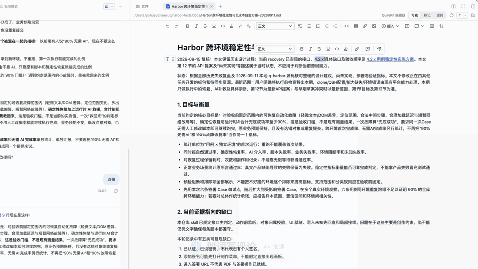
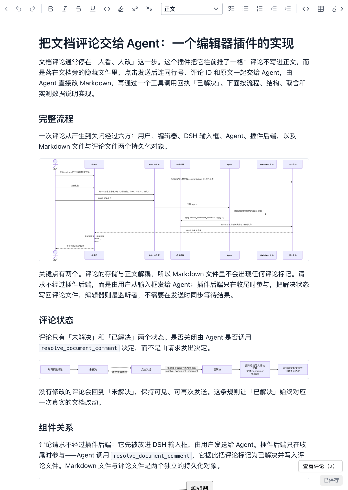

<div align="center">

# QuireKit MD Editor for DeepSeek Harness

在 Agent 写文档的地方直接编辑 Markdown，把评论交回给 Agent。

[](./LICENSE.md)
[](https://www.npmjs.com/package/dsh-quirekit-md-editor)
[](#安装)

[English](./README.md) | 简体中文



</div>

DeepSeek Harness 的右侧栏可以预览 Markdown，这个插件让预览可以直接编辑：打开 `.md` 文件，在渲染后的文档上修改，内容自动保存回原文件。编辑器是 [QuireKit MD Editor](https://msfe.quirekit.com/md-editor/)，可以在官网直接试用。

## 亮点

- **评论驱动 Agent。** 对一段文字写评论，发送给 Agent。Agent 改完后会把这条评论标记为已解决，没有处理的评论保持未解决。
- **长文档依然跟手。** 在 100 万字符的文档中，一次按键更新编辑器的中位耗时是 2.4 ms，P95 是 3.0 ms，详见[性能](#性能)。
- **文件还是你的文件。** 保存的仍是纯 Markdown，只改动你编辑的地方，其余内容逐字节不变。评论单独存放。

<p align="center"></p>

## 为什么是这个编辑器

DeepSeek Harness 里已经有几个能编辑 Markdown 的插件。这个插件关注的是 Agent 写完文档之后的事：你读、你改、你告诉 Agent 哪里要改。

- **评论是编辑器的一部分。** 评论和回复显示在正文旁边，并跟随文字移动。每条评论都能发给 Agent，处理完自动关闭。
- **每一次编辑都是在改 Markdown 纯文本。** 可视、标记、源码三种模式是同一个 CodeMirror 编辑器，区别只在显示方式。文件不会从文档树重新生成，改一个字符，diff 就只有一个字符。即使文档里有 Setext 标题、`*` 和 `+` 列表、波浪线代码块、原始 HTML 或不规整的表格也一样。`npm run benchmark:fidelity` 会在三种模式下验证这一点。
- **插件和编辑器一起打磨。** 编辑器由 QuireKit 基于优化过的 CodeMirror 和 Lezer 构建，插件需要的能力都进入了它的公开接口。

## 演示

在 DeepSeek Harness 桌面版里：选中文字发给 Agent、评论交给 Agent 并自动解决、一句话改成图文并茂；再切到 DSH 自带的预览看同一份 Markdown，对比三种编辑模式，以及评论在各模式下的显示。部分片段已加速，画面中有标注。

https://github.com/user-attachments/assets/fadc2a40-9e9d-4124-9d1a-ece760a4b7ab

## 功能

**编辑**

- 三种模式，每个标签页各自记住：可视编辑隐藏 Markdown 标记，标记编辑在当前段落显示标记，源码编辑显示全部原文。
- 公式、Mermaid、PlantUML、表格、脚注和 frontmatter 就地呈现。可以插入白板、流程图和思维导图，数据保存在 Markdown 里。
- 输入后自动保存，也可以按 `Cmd/Ctrl+S`。
- 粘贴的图片保存到文档旁的 `assets/` 目录，文档里写相对路径。
- 跟随 DeepSeek Harness 的语言和明暗主题。

**和 Agent 协作**

- 选中文字后发送到输入框，带上文件路径和行号，由你决定是否发送。
- 发送单条评论或全部未解决评论。Agent 通过 `resolve_document_comment` 工具逐条标记它处理过的评论。
- Agent 修改文件时：没有未保存内容就自动更新；有未保存内容就提示，由你决定保留哪一份，不会静默覆盖。
- 内置 `quirekit-markdown` Skill，让 Agent 写出提示块、折叠块、Mermaid、PlantUML 和公式。
- 本地截图支持相对路径和绝对路径，只读取图片文件。

<p align="center"></p>

右侧评论栏可以随时隐藏和展开，文档工具栏的下拉菜单可以随时切回官方的 Markdown 预览。

## 安装

需要 DeepSeek Harness `>=0.2.2-rc.1 <0.3.0`，Web 版和桌面版都可以。

```bash
dsh plugin --profile web add dsh-quirekit-md-editor
```

重启 `dsh web`，再从“文件”标签打开 Markdown。

桌面版在“插件”页点“添加插件”，输入 `dsh-quirekit-md-editor` 安装并启用。

从源码安装：

```bash
npm install
npm run build
dsh plugin --profile web add file:/absolute/path/to/dsh-md-editor
```

## 设置

在 DeepSeek Harness 的“插件”页可以设置默认模式、是否显示模式切换，以及格式工具栏固定、浮动或隐藏。设置保存在当前浏览器。

## 性能

这些数字来自插件实际运行的编辑器代码，运行在浏览器引擎中，没有原生渲染层。文档变长 10 倍，一次按键的开销增加不到三分之一，其余开销主要取决于文档的块数。这来自 QuireKit 对两个开源内核的优化：

- **优化过的 Lezer。** 编辑后整组复用没有变化的语法树分组，增量解析的开销不再随文档长度增长。链接定义没变时，编辑器也不再做第二轮解析。
- **优化过的 CodeMirror。** 在只绘制可见部分的基础上，快速滚动时按速度提前多绘制一段；重建绘制窗口时先锁定内容高度，滚动位置不会被带偏。

| 文档 | 字符数 | 模式 | 打开 | 更新 P50 | P90 | P95 | P99 | 下一帧 P50 | 下一帧 P95 |
| --- | ---: | --- | ---: | ---: | ---: | ---: | ---: | ---: | ---: |
| 长文 | 100,000 | 可视编辑 | 145 ms | 2.0 | 2.3 | 2.5 | 3.1 | 8.9 | 10.0 |
| 长文 | 100,000 | 标记编辑 | 115 ms | 2.0 | 2.4 | 2.5 | 3.4 | 9.2 | 10.2 |
| 长文 | 100,000 | 源码编辑 | 106 ms | 1.6 | 1.9 | 2.1 | 2.8 | 8.8 | 9.8 |
| 长文 | 1,000,000 | 可视编辑 | 113 ms | 2.4 | 2.9 | 3.0 | 3.4 | 9.1 | 10.2 |
| 长文 | 1,000,000 | 标记编辑 | 117 ms | 2.6 | 3.0 | 3.2 | 4.5 | 9.0 | 10.1 |
| 长文 | 1,000,000 | 源码编辑 | 106 ms | 1.8 | 2.2 | 2.3 | 2.8 | 8.9 | 9.8 |
| 结构密集 | 1,000,000 | 可视编辑 | 144 ms | 6.4 | 6.8 | 7.0 | 10.9 | 9.1 | 10.8 |
| 结构密集 | 1,000,000 | 标记编辑 | 141 ms | 6.6 | 7.1 | 7.3 | 9.3 | 9.3 | 10.5 |
| 结构密集 | 1,000,000 | 源码编辑 | 112 ms | 2.6 | 3.3 | 3.6 | 4.9 | 8.8 | 10.0 |

单位为毫秒，每行在文档中部连续输入 200 次，包含冷启动的输入。测试环境为 Apple M3 Max（同时运行着其他任务），Chromium 149。

编辑器运行在独立的 iframe 中，DeepSeek Harness 页面的样式不会影响它。在真实的右侧栏里（100 万字符、可视编辑、100 次按键），从输入到处理完并完成布局的 P50 约 4 ms，P95 约 5 ms。

- **更新**：从按键到编辑器接受新文档。
- **下一帧**：从按键到带有新文字的一帧生成完毕。
- **打开**：从创建编辑器到首次绘制。
- **长文**：每隔几千字符出现一些结构。**结构密集**：大约每 400 字符就有一张表、一段代码或一个提示块，是这里最坏的情况，开销随块数增长。

按键通过浏览器自动化协议发送，所以不包含键盘、操作系统、输入法和显示器的耗时。不同机器结果会有差异。你可以自己运行：

```bash
npm install
npx playwright install chromium
npm run benchmark
```

脚本会打印同样的表格，并把原始结果保存到 `build/benchmark/results.json`。测试场景在 [`benchmark/`](./benchmark) 目录。`npm run benchmark:fidelity` 用于验证原文保持不变。

## 基于 QuireKit

[QuireKit](https://quirekit.com) 是用来构建文档编辑器的开源框架，这个插件只是其中一个小例子。你在这里用到的编辑器，也是一个可以放进自己产品的组件：

```bash
npm install @quirekit/md-editor
```

接入方式见[接入指南](https://msfe.quirekit.com/guide/md-editor)。QuireKit 还包括这个编辑器底层的源码优先 Markdown 框架 [MSFE](https://msfe.quirekit.com/)、块编辑器，以及在浏览器里排出真实页面的分页编辑器。

开发过程和性能优化的细节，见我写的[这篇文章](https://yishuai.wang/articles/3e7d9243-24bc-4ed0-bd6f-0c20ee8f0e80)。

## 权限

- 编辑沿用当前会话的沙箱模式，只读会话中文档也是只读的。
- 只能保存工作区内的普通文件，不跟随符号链接。工作区外的 Markdown 可以打开，但是只读。
- 文档里的相对图片只能读取工作区内的图片文件。
- 所有请求都经过 DeepSeek Harness 的登录和同源校验。

## 使用限制

- 单个文件上限 4 MB，单张图片上限 20 MB。
- 同一文件混用 LF 和 CRLF 时不能编辑，请先统一换行符或切回 Markdown 预览。
- 粘贴图片只支持本地工作区，因为 DeepSeek Harness 的文件服务目前只能写文本。
- 打开 Markdown 文件时加载约 5.8 MB 的编辑器代码和样式（gzip 后约 1.8 MB）。公式编辑器、白板和图表引擎只在文档用到时才加载。安装包约 38 MB。
- 编辑器运行在 iframe 中：焦点在编辑器内时收不到 DeepSeek Harness 的全局快捷键，菜单也不会超出右侧栏。
- 和 dsh-marktext、dsh-better-sidebar 同时启用时，`.md` 默认用本编辑器打开。
## 开发

```bash
npm install
npm test
npm run build
```

构建产物是 `lib/client.js`，同时根据实际打包内容重新生成 `THIRD_PARTY_NOTICES.md`。

基于 QuireKit 本地代码构建或测试性能：

```bash
QUIREKIT_LOCAL=/absolute/path/to/quirekit npm run build
QUIREKIT_LOCAL=/absolute/path/to/quirekit npm run benchmark
```

## 参与贡献

欢迎提交 Issue 和 Pull Request。提交前请运行 `npm test`，可能影响输入性能的改动请附上 `npm run benchmark` 的结果。

## 许可

[MIT](./LICENSE.md)。打包内的依赖列在 [THIRD_PARTY_NOTICES.md](./THIRD_PARTY_NOTICES.md) 中。
